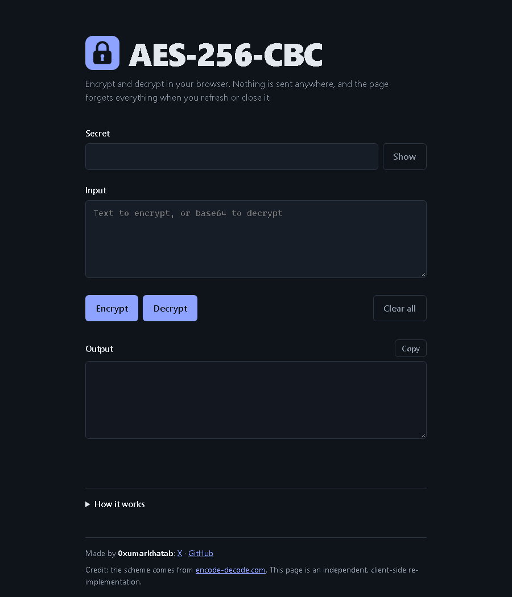

<p align="center">
  
</p>

# encrypt-decrypt

AES-256-CBC encrypt and decrypt with two inputs only: a secret and some text. There is no IV, padding, or mode setting to choose. The output matches [encode-decode.com](https://encode-decode.com/).



## What is in this repo

- `index.html`, `app.js`, `style.css`: a static web page. It runs in the browser with the Web Crypto API. No data leaves the page.
- `aes256cbc.js`: the same logic as a Node.js command line tool.
- `vercel.json`: strict security headers for hosting on Vercel.
- `assets/`: the logo, the screenshot, and the social preview image (`preview.png`).

## How it works

- Key: the secret as UTF-8 bytes, padded with zeros or cut to 32 bytes.
- IV: 16 zero bytes.
- Padding: PKCS#7.
- Output: base64.

## Use

Web page: open `index.html`, or deploy the folder as a static site.

Command line:

```sh
node aes256cbc.js encrypt <secret> <input>
node aes256cbc.js decrypt <secret> <base64-input>
```

## Security note

The IV is fixed, so the same input and secret always give the same output. This is for compatibility with encode-decode.com. Do not use it to protect real secrets.

## Credits

- Scheme and behaviour: [encode-decode.com](https://encode-decode.com/).
- Made by 0xumarkhatab: [X](https://x.com/0xumarkhatab), [GitHub](https://github.com/0xumarkhatab).
